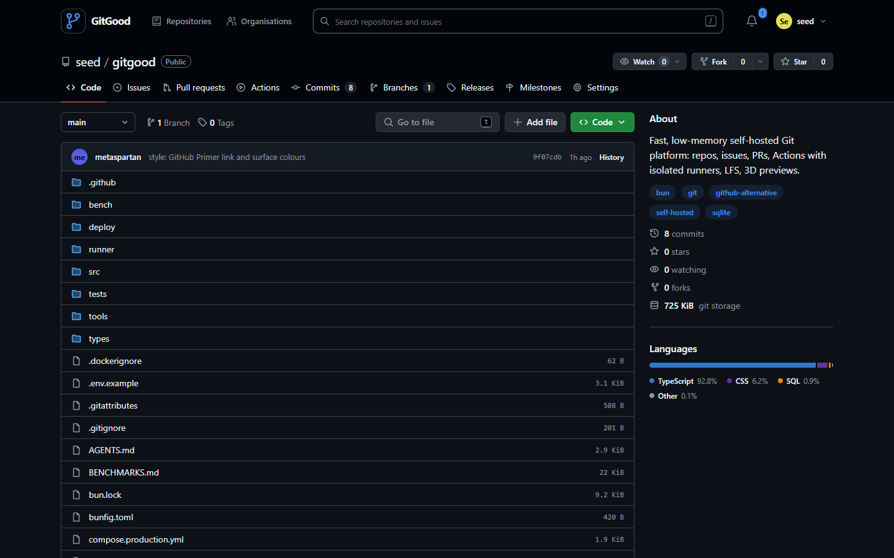

# GitGood

A fast, low-memory, self-hosted Git platform. Repositories, issues, pull requests with reviews, Actions-style CI with isolated runners, Git LFS, releases, organizations and a GitLab-style admin area — in one Bun process backed by SQLite.

GitGood is built for people who want GitHub's workflow on their own hardware without running a fleet of services. It idles at about 20 MiB of RAM — a fifth of Gitea and a fraction of a percent of GitLab's baseline — serves cached pages in single-digit milliseconds, and keeps every byte of your code on your machine.



## Performance and memory

Measured on the same Linux host (Docker 29, x86-64), each server freshly started with an empty SQLite database and capped at 2 GB, then hit with 200 sequential requests for its home page:

| | **GitGood** | Gitea 28.2 | Forgejo 11 | GitLab CE |
|---|---|---|---|---|
| Idle memory (RSS) | **21 MiB** | 100 MiB | 106 MiB | not measured — needs 16 GB baseline, 8 GB constrained¹ |
| Memory after 200 requests | **24 MiB** | 110 MiB | 119 MiB | 2–2.5 GB + 1 GB swap for ≤5 users in a tuned setup² |
| Mean request time incl. client process spawn | **4.3 ms** | 5.3 ms | 5.2 ms | – |
| Container image | 219 MB | 249 MB | 245 MB | several GB (omnibus) |
| Services inside | 1 | 1 | 1 | Puma, Sidekiq, Gitaly, Workhorse, PostgreSQL, Redis, NGINX… |

The request figure is dominated by spawning `curl` for each request, so read it as "all three are fast", not as a precise ratio. GitGood serves a cached HTML shell and renders in the browser; Gitea and Forgejo render server-side.

A real deployment stays small too: an instance hosting a 21,000-file game repository with 279 branches and over 43,000 Git LFS objects (~71 GB) runs at **16–17 MiB RSS**. GitHub is a hosted service and is not comparable on resource use.

Reproduce: `docker run -d --tmpfs /data:uid=1000,gid=1000 -e GITGOOD_DATA_DIR=/data gitgood`, wait a minute, then `docker stats --no-stream`. `bun run bench` covers API throughput and git transfer speed on your own hardware.

## How it compares

| | **GitGood** | GitHub | GitLab (self-managed) | Gitea / Forgejo |
|---|---|---|---|---|
| Self-hosted | ✅ | Enterprise Server only | ✅ | ✅ |
| Services to operate | **1** (Bun + git) | n/a | Rails, Puma, Sidekiq, Gitaly, PostgreSQL, Redis, NGINX… | 1 binary + database |
| Database | Embedded SQLite (WAL) | n/a | PostgreSQL | SQLite / PostgreSQL / MySQL |
| Git over HTTPS and SSH, Git LFS | ✅ | ✅ | ✅ | ✅ |
| Issues, pull requests, reviews, milestones, assignees | ✅ | ✅ | ✅ | ✅ |
| Actions-style CI, on by default, jobs never run on the server | ✅ external runners, fresh container per job | ✅ | ✅ | ✅ |
| 3D preview (GLB / glTF / OBJ / PLY / STL / 3MF) incl. KTX2 + meshopt | ✅ with before/after diffs | STL | STL | – |
| Image diffs, including LFS images | ✅ | ✅ | ✅ | ✅ |
| Admin area: users, block, roles, sign-out, 2FA reset, runners, settings, audit log, backups | ✅ | Enterprise | ✅ | ✅ |
| Account security: TOTP, passkeys, scoped tokens, active session management | ✅ | ✅ | ✅ | ✅ |
| Themes | 38 incl. GitHub 1:1, per-user "sync with system" | ✅ | ✅ | ✅ |
| Production dependencies | 3 npm packages (react, react-dom, three), 0 known vulnerabilities (OSV) | n/a | hundreds | Go modules |

¹ [GitLab installation requirements](https://docs.gitlab.com/install/requirements/) · ² [Running GitLab in a memory-constrained environment](https://docs.gitlab.com/omnibus/settings/memory_constrained_envs/)

## Quick start

### Docker (recommended)

```bash
git clone https://github.com/metaspartan/gitgood.git
cd gitgood
docker compose up -d --build
docker compose logs gitgood | grep -i administrator   # first-run admin credentials
```

Open <http://localhost:3000> and sign in as `admin` with the printed password, then change the username, email and password under **Settings** (a banner reminds you until you do).

### Bun (no Docker)

Requires [Bun](https://bun.sh) 1.4+ and `git` 2.30+ (plus `git-lfs` if you use LFS).

```bash
git clone https://github.com/metaspartan/gitgood.git
cd gitgood
bun install
bun run build:web
bun start
```

Set `GITGOOD_ADMIN_PASSWORD` before the first start to choose the admin password instead of having one generated.

### Push your first repository

```bash
git remote add origin http://localhost:3000/admin/my-project.git
git push -u origin main
```

Create the repository first from the web UI (**New repository**) or `POST /api/repos`. For scripts and agents, create a personal access token under **Settings → Access tokens** and use it as the password.

## Actions (CI)

Actions are enabled for every repository by default. Add `.gitgood-ci.yml` to the default branch:

```yaml
name: CI
on: [push, workflow_dispatch]
jobs:
  test:
    runs-on: oven/bun:1        # any container image, or ubuntu-latest / node / bun / alpine
    steps:
      - name: Install
        run: bun install
      - name: Test
        run: bun test
```

The server never runs repository code. Jobs wait in a queue until a **runner** picks them up:

1. Register a runner and copy its token (shown once). Administrators add instance runners under **Admin → Runners**; anyone can add runners for their own repositories under **Settings → Runners**, or for one repository under its **Settings → Actions runners**.
2. On any machine with Docker:

   ```bash
   GITGOOD_RUNNER_URL=http://your-gitgood-host:3000 \
   GITGOOD_RUNNER_TOKEN=ggr_… \
   docker compose --profile runner up -d runner
   ```

   or without Docker for the runner process itself: `bun runner/gitgood-runner.ts --url … --token …`.

Each job runs in a fresh container (memory, CPU and PID limits, `no-new-privileges`), the commit is delivered as an archive, logs stream live to the Actions tab, and the container is removed afterwards. Restrict images with `--allowed-images "oven/bun:*,ubuntu:24.04"`. Owners can turn Actions off per repository in **Settings → Features**; administrators set the default in **Admin → Settings**.

`GITGOOD_CI_MODE` selects the execution model: `runner` (default in production), `trusted-host` (runs jobs directly on the server — only for single-user machines you trust), or `disabled`.

## Features

- **Code**: file browser with latest-commit bar, "Go to file" fuzzy finder (`t`), blame, raw/archive downloads, syntax highlighting, virtualized large-file viewer, Markdown READMEs, image/audio/video/3D previews, in-browser editing.
- **History**: commits grouped by day with expandable descriptions, commit pages with per-file menus, image and 3D diffs, branch compare.
- **Collaboration**: issues and pull requests with reviews, comment editing and emoji reactions, GitHub-style profiles (profile README, pinned repositories, bio and links, contribution graph from git history with yearly activity timeline), required checks, merge policies, labels, milestones, assignees, event timelines, notifications, mentions, stars, watches and forks.
- **Organizations** with owner/admin/member roles and per-repository collaborators.
- **Git LFS** (batch API, locks) with deduplicated storage and per-repository usage.
- **Webhooks** with SSRF protection, delivery history and retries.
- **Security**: Argon2id passwords, TOTP and passkeys (password-only Git/API access is refused once two-factor is on), scoped and repository-pinned tokens, per-account and per-IP login throttling, strict CSP, CSRF protection, masked 404s for private resources, blocked-user enforcement across web, API, Git and SSH.
- **Administration**: GitLab-style admin area with user search, roles, blocking, sign-out-everywhere and two-factor reset, runner management, instance settings and a searchable audit log of every administrative change.
- **Account**: profile, password, TOTP with recovery codes, passkeys, scoped access tokens, per-browser themes and an active-sessions list with one-click revoke, commit emails (with suggestions from your repositories) and an option to count private contributions on your profile.
- **Operations**: scheduled backups with retention to local, NAS or Google Drive (sign in with Google, no extra software) destinations, managed and tested from the admin area, storage quotas, readiness/health endpoints, Prometheus-style metrics, structured logs.

## Configuration

All settings are environment variables; see [`.env.example`](.env.example) for the full list.

| Variable | Default | Purpose |
|---|---|---|
| `GITGOOD_PORT` / `GITGOOD_HOST` | `3000` / `0.0.0.0` | Listen address |
| `GITGOOD_BASE_URL` | `http://localhost:3000` | Public URL used in clone hints and links |
| `GITGOOD_DATA_DIR` | `./data` | Database, repositories and LFS objects |
| `GITGOOD_ADMIN_PASSWORD` | generated | First-run administrator password |
| `GITGOOD_CI_MODE` | `runner` (production) | `runner`, `trusted-host` or `disabled` |
| `GITGOOD_ALLOW_SIGNUP` | `true` | Initial value; change later in Admin → Settings |
| `GITGOOD_TRUST_PROXY` | `false` | Honour `X-Forwarded-*` behind your own reverse proxy |
| `GITGOOD_MAX_REPO_BYTES` | `0` (unlimited) | Default per-repository quota |

Production deployment, TLS, SSH and backups are covered in [DEPLOYMENT.md](DEPLOYMENT.md).

## Architecture

```
src/
  server.ts        HTTP entry: git smart HTTP + LFS, JSON API, SPA shell
  api/             routes, validation, serialization
  auth/            sessions, tokens, passwords, MFA, throttling
  data/            SQLite data access and cached git reads
  git/             git process runner, diff/tree/blame/archive helpers
  lfs/             LFS batch API, object store, usage accounting
  ci/              workflow parser, queue, runner protocol
  web/             React SPA (code-split per route, three.js loaded only for 3D)
runner/            standalone CI runner agent
tools/             build, seed, backup/restore and admin CLIs
tests/             unit and integration tests (bun test)
```

Design rules: no ORM, no framework on the server, every git call bounded by concurrency and output limits, every cache bounded in entries and bytes, and no request ever buffers an unbounded body.

## Development

```bash
bun install
bun run seed        # optional: large demo dataset
bun run dev         # hot-reloading server on :3000
bun test            # full suite
bun run typecheck
```

See [AGENTS.md](AGENTS.md) for conventions used by contributors and coding agents.

## Security

Please report vulnerabilities privately as described in [SECURITY.md](SECURITY.md).

## License

[MIT](LICENSE) © Carsen Klock
